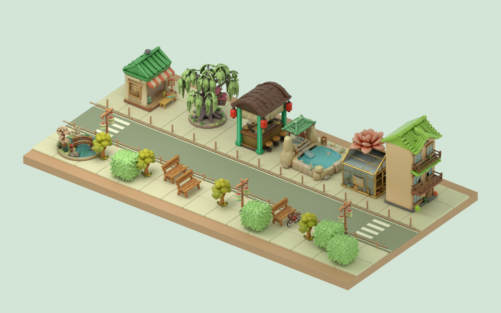

# 花灯里：星匣市首富

一个基于 Three.js 的治愈系 3D 街区经营游戏，为星匣模拟经营 Game Jam 制作。



> 上图为 Blender 场景渲染，实际游戏采用可旋转、可缩放的交互街区。

## 玩法

从一家拉面店开始，建造商店、住宅和庭园，调整价格，观察居民消费，并用每日利润扩建街区。

- 8 个经营地块；拉面店、书屋、花店、温泉、住宅、树屋、庭园。
- 售价影响客流和满意度，天气与街区活动改变需求。
- 建造、升级、拆除、每日收支报告与破产救济。
- 14 天挑战：资金达到 5,000、满意度达到 80、拥有 4 家商店；之后可继续经营。
- 星匣 SDK 云存档：建造、调价、升级和每日结算触发保存。
- 12 件独立 GLB 资产，建筑及摆件由 Tripo 生成，场景由 Blender 组装。

## 本地开发

建议使用 Node.js 24。运行：

```sh
npm ci
npm test
npm run build
npx vite --host 127.0.0.1
```

普通浏览器直开仅用于临时试玩，不能验证星匣握手与云存档。加载失败时请检查控制台及模型请求；GLB 资产共约 95 MiB，首次加载需要一些时间。

## 星匣预览与草稿

当前游戏 ID：`12281`，当前交付状态：**草稿，尚未正式发布**。

安装并登录官方 `star-letter` CLI 后：

```sh
npm run build
star-letter check
star-letter dev --open
star-letter status
star-letter publish --draft
```

`dev` 会输出本机有效的 `/dev/preview` 链接；预览 token 随本机服务而变化，不应写进公共 README。`star-letter.json` 使用目录发布模式，完整上传 `dist`。其他创作者 fork 本仓库时应先创建自己的星匣游戏并替换 `gameId`，不能更新此项目的游戏。

模拟存档配置仅用于开发，采用进程内 Map，重启预览服务后不保留。真实存档需在平台预览页切换 storage 为真实模式后测试。读取云档失败时只开放临时试玩，不覆盖未知云档。

## 工程结构

| 路径 | 用途 |
| --- | --- |
| `src/sim.js` | 经营规则、结算及存档校验 |
| `src/world.js` | Three.js 场景、模型、相机与点击地块 |
| `src/main.js` | 界面、经营交互与 SDK 存档 |
| `public/models/` | 12 件可复用 GLB |
| `scripts/build_scene.py` | 从资产重建 Blender 场景 |
| `assets/catalog.json` | 资产设计描述 |
| `tests/sim.test.js` | 经营逻辑测试 |
| `output/GAME-QA.md` | 验证证据与待办 |

Blender 场景重建（已使用 Blender 5.2.3 验证）：

```sh
blender --background --factory-startup --python scripts/build_scene.py
```

生成 `output/street.blend`、`output/street.png` 和资产清单。生成脚本优先使用本机 Tripo 原始文件，没有时使用仓库内 `public/models`。无需重新调用 Tripo 即可运行游戏或重建场景。

## 当前验证与待办

6 项逻辑测试通过，生产构建与星匣结构检查通过。浏览器玩法、真实云存档和移动端布局仍需平台内验收。广告补给、活动报名与公开发布尚未完成。

参考 [Minami Lane](https://store.steampowered.com/app/2678990/Minami_Lane/) 的街区经营与美术方向；[活动介绍](https://www.virtualoverapp.com/cms/286687/xxgamejam2.html)。仓库不包含参考游戏截图或原作模型。公开仓库不代表授予额外的代码或美术许可；本仓库尚未选择开源许可证。
